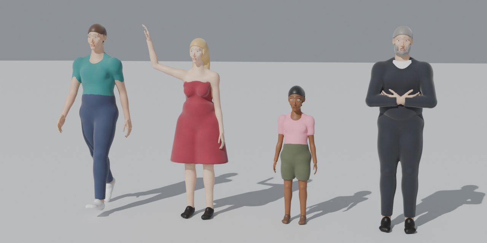
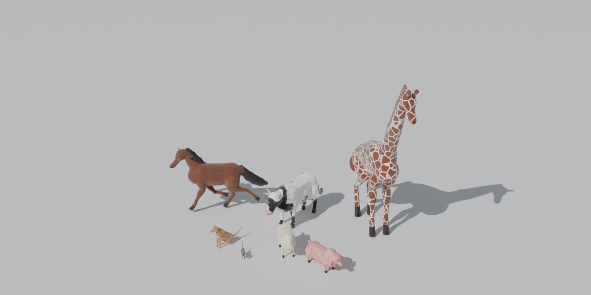
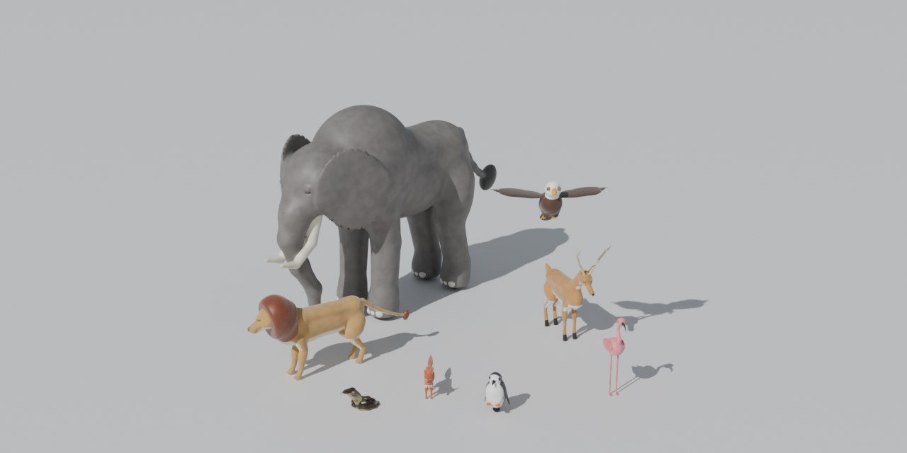

# NaturalForm

**Procedural humans, animals and organic creatures for Blender, built to be driven by LLM agents.**

An LLM connected to Blender through an MCP server (for example
[blender-mcp](https://github.com/ahujasid/blender-mcp), which exposes an
`execute_blender_code` tool) can't model organic shapes vertex by vertex. It
ends up stacking primitives into snowmen. NaturalForm gives it a vocabulary
instead: *"a 7-year-old girl in shorts waving"*, *"a horse galloping"*,
*"a dragon with wings"*. One Python call returns a smooth, rigged, textured
mesh.





```python
import naturalform as nf
nf.create("woman", age=34, hair_style="bob", clothing="dress", pose="wave")
nf.create("horse", location=(2, 0, 0), rotation=(0, 0, 90), pose="run")
nf.create("eagle", location=(0, 3, 4), pose="fly")
```

## Features

- **Templates with real anatomy.** Humans have age, sex, build, face, hair,
  beard and clothing parameters. There are 33 quadrupeds, 14 birds, 11 fish
  and sea mammals, and 8 snakes and worms. Presets are just parameter sets,
  so anything can be overridden (`nf.create("dog", ear_type="pointed",
  color="black")`).
- **Custom creatures.** An editable `Creature` spec of smooth-blended shapes
  (chains, ellipsoids, capsules, boxes, tori, eyes, carved holes, clip
  planes, mirrored parts, clothing layers). Bones are created automatically,
  so dragons, centaurs, aliens or a pegasus get a rig for free.
- **Rigged by default.** You get an armature with smooth weights computed
  from the shapes. Pose presets (walk, run, sit, wave, graze, fly, swim and
  more) or a simple pose syntax (`{"head": [0, 0, 30]}`,
  `{"upper_arm.R": {"aim": [0, -1, 0.3]}}`). Poses can be applied before
  meshing, for perfect joints, or through the rig afterwards.
- **Procedural materials.** Skin, fur, wool, scales, feathers, hair, keratin
  and eyes, with countershading and stripes, spots, rosettes, patches and
  giraffe patterns. No UVs are needed, and patterns stick to the body when
  it is posed.
- **Built for LLMs.**
  - Plain-value inputs and dict outputs.
  - Real-world sizes and fixed conventions.
  - `nf.help()` prints a guide inside Blender.
  - Errors say how to fix the call (`unknown parameter 'colour'. Did you mean color?`).
  - `nf.focus()` frames creatures for viewport screenshots.
  - `nf.rebuild()` iterates on a creature in place.
- **Pure Python and numpy.** Nothing to install beyond Blender itself.

## Install

Requires **Blender 4.2 or newer** (tested on 5.2).

1. Build the package: `python scripts/build_zip.py`. This writes
   `dist/naturalform-1.0.0.zip`.
2. In Blender, go to **Edit › Preferences › Get Extensions**, open the
   **⌄** menu, choose **Install from Disk…**, pick the zip and enable it.
   - You can also use `dist/naturalform-1.0.0-legacy.zip` with
     **Add-ons › Install from Disk** (legacy add-on).
   - Or copy the `naturalform/` folder into your add-ons directory.

The add-on adds:

- a **NaturalForm** tab in the 3D View sidebar (N panel);
- an **Add › NaturalForm** menu;
- the Python module `naturalform`. It is importable as `import naturalform`
  however it was installed, because the add-on registers that alias.

## Using it with an LLM over MCP

1. Install and start your Blender MCP server, for example blender-mcp.
2. Enable NaturalForm in Blender.
3. Tell the assistant about it. Either paste [`docs/LLM_GUIDE.md`](docs/LLM_GUIDE.md)
   into its system prompt or project instructions, or just say:
   *"Blender has the NaturalForm add-on: run `import naturalform as nf; nf.help()`
   first."* The **Copy LLM Guide** button in the sidebar puts the guide on your
   clipboard.

A typical tool call the assistant sends:

```python
import naturalform as nf
r = nf.create("lion", location=(0, 0, 0), rotation=(0, 0, 30), pose="sit")
print(r)          # {'name': 'Lion', 'mesh': 'Lion_mesh', 'armature': 'Lion', 'dimensions_m': [...], ...}
nf.focus("Lion", view="three_quarter")   # then take a viewport screenshot
```

## API at a glance

| Call | What it does |
|---|---|
| `nf.create(name, **params, **build)` | Any creature by name: `"man"`, `"girl"`, `"old woman"`, `"dog"`, `"kitten"`, `"giraffe"`, `"owl"`, `"shark"`, `"python"`… |
| `nf.create_human / create_quadruped(species) / create_bird / create_fish / create_serpent` | Same, per template |
| `nf.spec(name, **params)` → `Creature` | Editable spec to customise before `.build()` |
| `nf.Creature(name)` | Build anything from scratch (`help("custom")`) |
| `nf.pose(name, preset_or_dict)` / `nf.reset_pose(name)` | Pose through the rig |
| `nf.rebuild(name, **params, pose=, detail=)` | Change parameters or pose and re-mesh in place |
| `nf.load(name)` → `Creature` | Get the spec of a built creature back |
| `nf.describe(name)` / `nf.bones(name)` | Parameters, parts, joint positions |
| `nf.focus(name, view=)` | Frame in the viewport (front, side, top, three_quarter…) |
| `nf.help(topic)` / `nf.list_species()` / `nf.list_poses(kind)` / `nf.params(kind)` | Discovery |

**Build options** (every create or build call):

- `name`
- `location`
- `rotation` (degrees)
- `scale`
- `detail`: `preview`, `low`, `medium` (default), `high` or `ultra`
- `pose`
- `rig`
- `collection`
- `replace`

An explicit `name` replaces an existing creature of that name. Without one,
names are made unique (`Dog`, `Dog.001`…).

**Conventions:**

- Units are metres and +Z is up.
- Creatures stand on `location`; fish are centred on it.
- Creatures face **-Y**, and their left side is **+X**.
- Left and right parts and bones end in `.L` / `.R`.

### Custom creature example

```python
import naturalform as nf
c = nf.spec("horse", color="white", mane_color="platinum")       # start from a template
c.chain("wing.L", [(0.2, -0.45, 1.55), (0.9, -0.35, 2.0), (1.8, -0.1, 2.3)], [0.08, 0.22, 0.04],
        parent="chest", squash=0.15, squash_dir=(0, 0, 1), mirror=True)   # + right wing
c.build(name="Pegasus", pose="walk")
```

See `nf.help("custom")` (or [the guide](docs/LLM_GUIDE.md)) for the full
builder API, including a dragon built from scratch.

## Performance

Build times at `medium` on a laptop-class CPU:

| Creature | Time |
|---|---|
| Animal | about 1–4 s |
| Clothed human | about 5 s |

`preview` and `low` take about 1 s, and `high` 5–15 s. If an MCP client
times out on a big build, Blender still finishes it. Inspect the scene, or
use a lower `detail` for drafts.

## How it works

Each creature is a list of signed-distance primitives (round cones,
ellipsoids, boxes, tori, plane-clipped shapes) combined with smooth unions
and subtractions.

1. **Meshing.** Each surface layer (body, hair, clothing, horns…) is meshed
   with narrow-band evaluation and surface nets in numpy. Vertices are then
   projected onto the exact iso-surface and relaxed.
2. **Detail regions.** Areas such as faces and hands are meshed finer and
   zipped into the body mesh along clean seams, so fingers and lips stay
   cheap.
3. **Material borders.** Borders between materials are snapped to the curve
   where two materials meet, which avoids voxel staircases.
4. **Rigging and attributes.** Bone weights come from distances to each
   bone's shapes. Rest positions and countershading masks are stored as mesh
   attributes for the procedural shaders.

The geometry core (`naturalform/core`, `naturalform/templates`) has no
Blender dependency.

## Development

```bash
python tests/run_tests.py                                  # core + templates (needs numpy)
blender -b --factory-startup --python tests/run_tests.py   # + Blender integration tests
python scripts/gen_llm_guide.py                            # refresh docs/LLM_GUIDE.md
python scripts/build_zip.py                                # package
```

`pip install bpy` also works for running the integration tests outside
Blender. Use a `bpy` version that matches your Python.

`examples/gallery.py` builds the scenes shown above.
